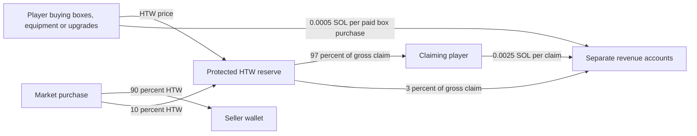

# HTW reserve and transparency

[Repository home](../../README.md) · Deployment observations: October 15, 2026

HEATWAVE uses a **program-controlled HTW reward reserve** with separate revenue accounts. The deployed program's upgrade authority was removed, and an initial **66,000,000 HTW** deposit was finalized. The program has no direct administrator-withdrawal instruction. Fees can still reach the separate revenue wallet through the documented payment paths.

These are specific verifiable properties, not a claim of absolute safety. The game backend is trusted to validate earned rewards. **A compromised or dishonest backend can authorize fabricated claims to wallets it controls**, subject to the on-chain checks. The program cannot independently prove that someone completed a game mission. No independent third-party security audit is claimed.

## Public addresses

All addresses below are on **Solana Mainnet**. The token has six decimals and uses Token-2022.

| Purpose | Address |
| --- | --- |
| Official HTW mint | [`HKrTVBPVF9B8LEkNvZDm4PeNScnvoHv8JxNMTahVpump`](https://solscan.io/token/HKrTVBPVF9B8LEkNvZDm4PeNScnvoHv8JxNMTahVpump) |
| Immutable reserve program | [`Aw3675He2MqACz3zkKi2hVEFpSdoYK5H8UG95kRoMD8k`](https://solscan.io/account/Aw3675He2MqACz3zkKi2hVEFpSdoYK5H8UG95kRoMD8k) |
| ProgramData | [`HJGvwxrc4Lt9VqcvA76h4nYcBrcCZjQUrBSoaSNZKB9G`](https://solscan.io/account/HJGvwxrc4Lt9VqcvA76h4nYcBrcCZjQUrBSoaSNZKB9G) |
| Reserve configuration | [`Ee4yrRSrhc4uJVggTaMYjKDmJ1jMbH3fiEC2XV1XrH3s`](https://solscan.io/account/Ee4yrRSrhc4uJVggTaMYjKDmJ1jMbH3fiEC2XV1XrH3s) |
| Program-derived reserve authority | [`6EdMCL6v28RjoBSDn7wk2nwYb8H4w6MXM3xaW6spky8v`](https://solscan.io/account/6EdMCL6v28RjoBSDn7wk2nwYb8H4w6MXM3xaW6spky8v) |
| Reserve HTW token account | [`8CBg3dSMm9YdAJL1rGgVaV8Ek3gyzNEBiktpZGe2LHX`](https://solscan.io/account/8CBg3dSMm9YdAJL1rGgVaV8Ek3gyzNEBiktpZGe2LHX) |
| Revenue wallet for studio SOL fees | [`4Efsdp2PYBseESD4oqFfe2Sm4D9Tq6fbTVm4KztxiHVz`](https://solscan.io/account/4Efsdp2PYBseESD4oqFfe2Sm4D9Tq6fbTVm4KztxiHVz) |
| Revenue HTW account for the 3% claim fee | [`6yaFm9NeQMobWWS9wh6JMtMLcSVXzbSywQDUe9M9cW6r`](https://solscan.io/account/6yaFm9NeQMobWWS9wh6JMtMLcSVXzbSywQDUe9M9cW6r) |

The reserve authority is a program-derived address, not an administrator's spending key. The older administrator-controlled Squads treasury is a separate setup and is **not** the protected reserve listed here.

## Finalized deployment evidence

| Operation | Mainnet transaction | Finalized slot |
| --- | --- | ---: |
| Initialize this reserve configuration | [View initialization](https://solscan.io/tx/4heJ1bcZmAtFt3My3Bqmz3sNeCVQ8WapvK9hZvXoDKh4DTcspkyUMRb5RPpzVgVQFkfaivqmXmbr1reKBwN7BZur) | 457216828 |
| Remove program upgrade authority | [View authority removal](https://solscan.io/tx/343dumdvkQnqjfs4ACJVhmqY8fsB9kXM8xG9ndVPhvFcaDerxUhmUtS7wpS15PeFBvMZv41994gmpBvA9oRbj5nR) | 457217087 |
| Deposit 66,000,000 HTW | [View initial funding](https://solscan.io/tx/5bG8QhsmeTkv1hT1APzhdHVbNAdA7VRRvxFvMTYKrGuNxXJNvGJQ6T4vCfwgqQoeQxrLnNkhz2gzUELzdg7WeuCi) | 457217221 |

The deposited amount supersedes the earlier 60-million proposal. It is **not a live balance**. Later purchases, fees and claims can change the reserve. Use the token account's current on-chain balance and the game's recorded liabilities together when assessing backing; token balance alone does not disclose every off-chain obligation.

Verified ELF payload: **210,168 bytes**. SHA-256:

```text
534f800c9c68c572dc8afb45103c9afce7ab3d8af272936b43cd04452014add3
```

The [contract source](../../programs/protected-reserve/src/lib.rs), [build/test instructions](../../programs/protected-reserve/README.md), and [machine-readable public evidence](reserve-evidence.json) are available for inspection. An ELF payload hash must be compared with the deployed executable payload, excluding loader metadata/padding as appropriate; hashing an entire account export is not the same measurement. Publication of source and a recorded hash is not an independent reproducible-build audit.

## What the program allows

The implemented entry points are `initialize`, `register_player` and `claim`. There is no administrator withdrawal, arbitrary transfer, arbitrary external-program call, key rotation, configuration-update or recovery instruction. The reserve's signing authority is used only for the fixed claim token-transfer paths.

A successful claim requires both the player and the configured backend signature on the complete transaction. The program checks the official mint and canonical accounts, prior registration, seven-day first-claim age, 2,500 HTW pre-payout holding, at least 100,000 HTW gross, claim expiry, replay protection, available gross backing and numeric counters. It sends 97% of gross to the player and 3% to the fixed revenue token account, plus 0.0025 SOL from the player to the revenue wallet.

The initialized per-claim, player-daily, global-daily and lifetime limits are all `18446744073709551615` token atoms (`u64::MAX`); fixed safety retention is `0`. Therefore no lower commercial withdrawal ceiling or retained 6-million reserve floor is configured. Protocol arithmetic is still finite, and a withdrawal needs sufficient backing.

Removing upgrade authority prevents replacement of this program's executable code through the loader. It does not make the off-chain game server decentralized, validate gameplay automatically, protect token market price or guarantee uninterrupted service.

## Where funds move



The operator can spend funds already received in the revenue accounts. It cannot use that revenue wallet's private key to directly withdraw the reserve's deposited HTW. The 3% claim fee leaves the reserve only as part of a successful claim; it is not a standing allowance to extract 3% of all deposited tokens. Market fees and paid progression HTW replenish the reserve, not the revenue wallet. Crafting and repairs that consume materials do not transfer tokens.

## Trust boundaries and operational risks

- **Gameplay authorization:** the backend decides whether activity earned a credit. There is no independent human co-signer or on-chain proof of the mission outcome.
- **Backend key:** losing the configured signing capability can permanently prevent claims from this immutable instance. This contract has no replacement-key or emergency recovery path. A compromised signer can authorize false claims; player signatures alone do not remove that risk because an attacker can control a player wallet.
- **Backing:** the server reserves recorded liabilities and uncertain payouts before admitting more rewards. Those accounting checks are off-chain. The contract itself sees token balances and the submitted claim, not the full game database.
- **Availability:** the game, RPC service and signing service must be available. A service outage or an unqualified chain observation can suspend transaction preparation.
- **Software:** the isolated [contract runtime tests](../../programs/protected-reserve/tests/README.md) cover signatures, replay, account substitution, fee arithmetic, timing, backing and atomic rollback. Application tests and private operational records are outside this contract-only repository. Passing tests does not establish that every defect has been found.
- **Markets:** HTW and item values can fall, and buyers may be unavailable. The reserve does not promise a redemption price for boxes, items or externally purchased HTW.

This documentation distinguishes verified deployment facts from application readiness. A finalized reserve deposit does not, by itself, prove public hosting availability or completion of every real-player purchase and withdrawal path.
